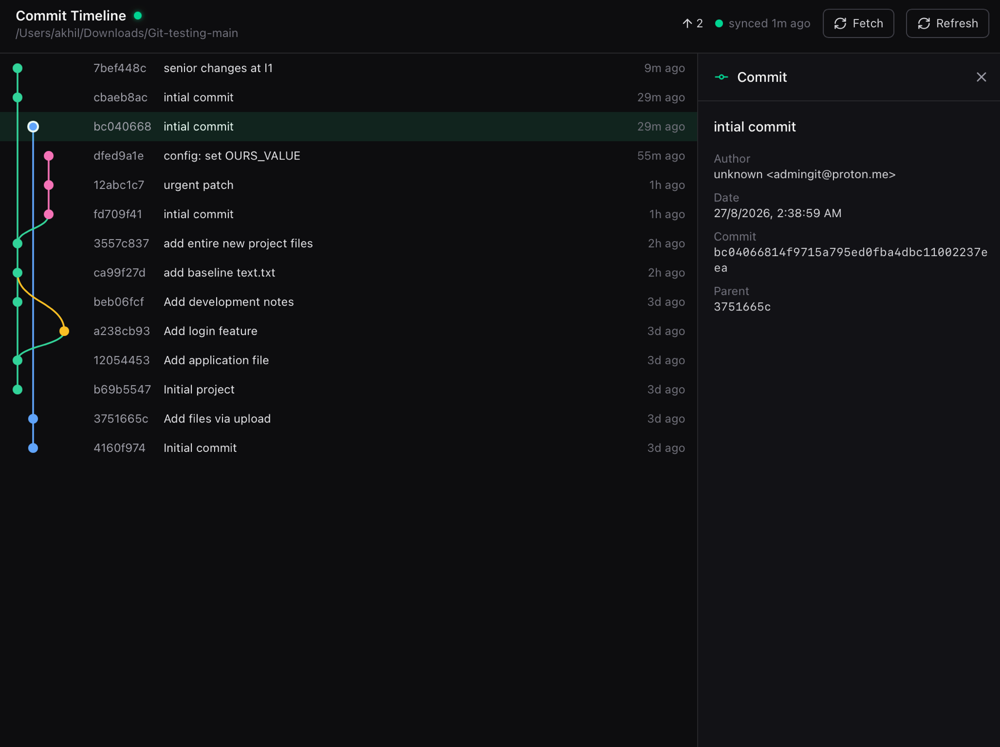
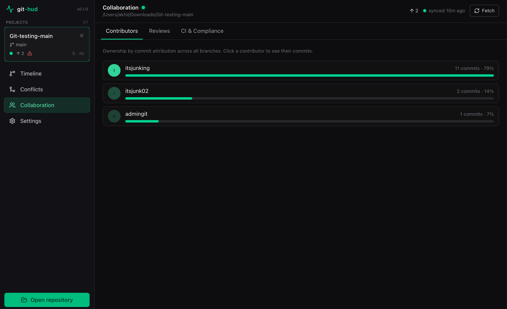
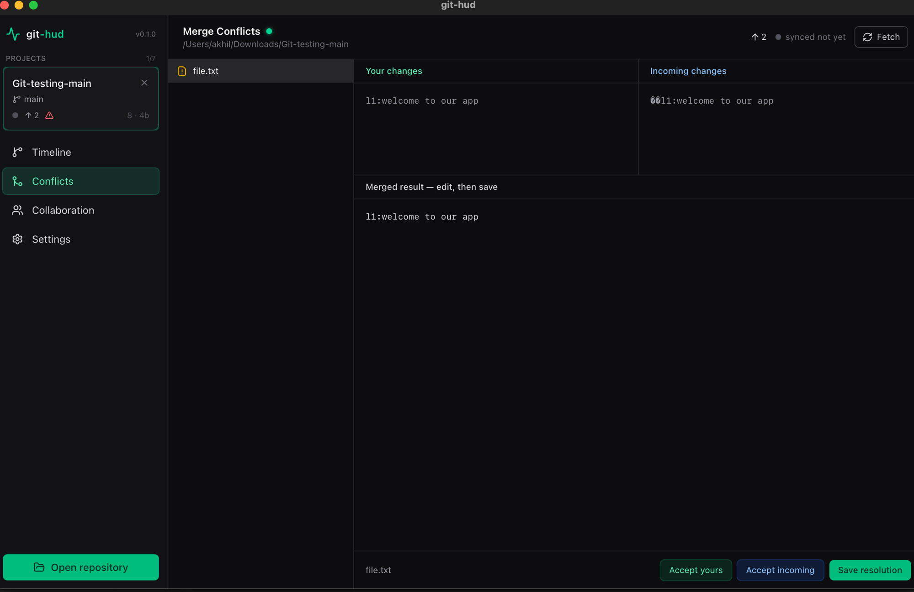
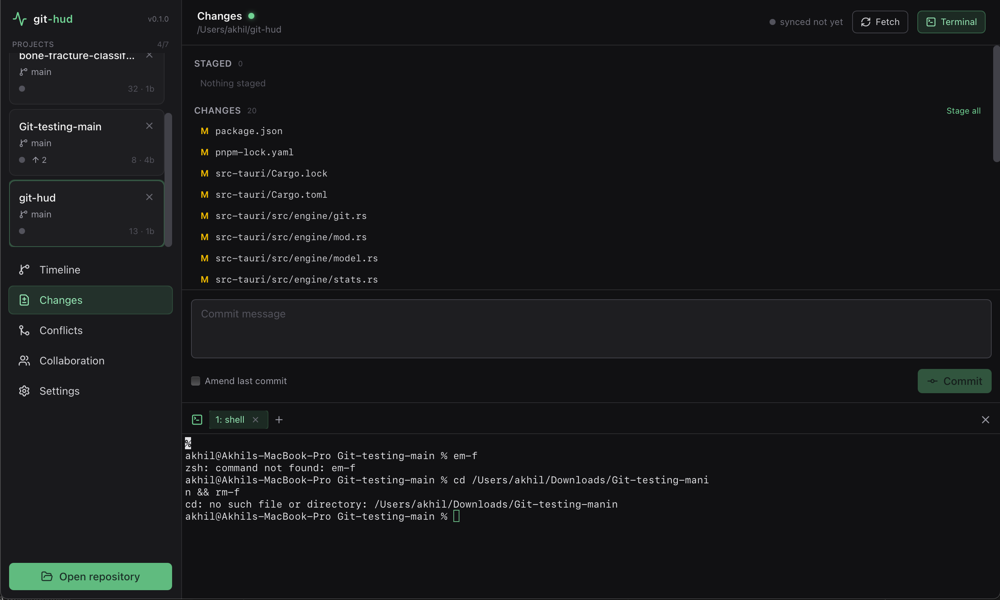
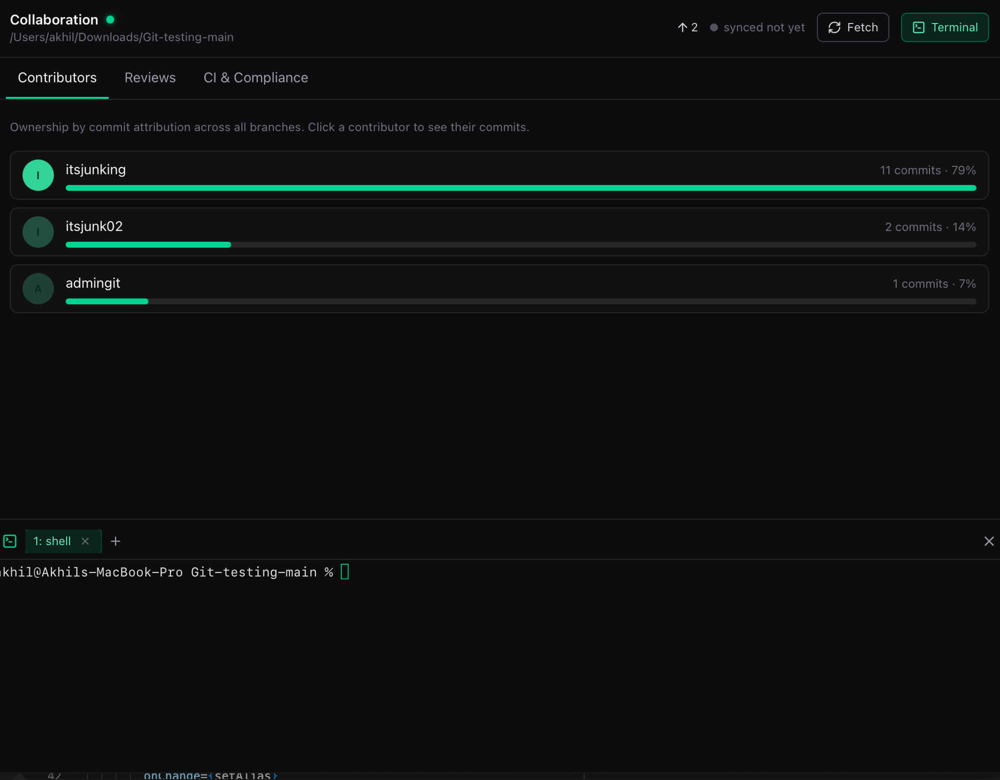

<div align="center">

# git-hud

**A lightweight, high-performance, cross-platform Git HUD for individuals and teams.**

Local-first · Zero-latency · Open source (MIT)

Built with **Tauri v2** · **Rust** (`git2` + SQLite) · **React 19 + TypeScript**

</div>

---

git-hud is a desktop Git GUI that treats your repositories as a live heads-up display.
A background Rust engine parses Git directly through `libgit2` (no shelling out to the
`git` CLI), caches derived metrics in local SQLite, and streams change events to a
React/Canvas frontend. Browse your history, **stage and commit**, resolve conflicts, and
drop into a **built-in terminal** — all without leaving the HUD.

## 📸 Screenshots

### Commit & branch timeline
Canvas-rendered graph across every branch, with a full commit-detail inspector.



### Collaboration dashboard
Ownership by commit attribution across all branches, resolved to GitHub-style usernames.



### Merge conflict editor
Three-way sides with one-click resolution or a hand-edited, savable merge — plus **blame-based attribution**: the merge banner, `who ↔ whom` conflict-pair chips, and a per-region author breakdown.



### Stage, commit & the Changes view
Stage and unstage per file or in bulk with a **split index/worktree model**, then commit (with amend) — all driven straight through `libgit2`.



### Integrated terminal
A real **PTY-backed shell** docked as a collapsible, tabbed bottom panel. Run `git` (or anything) without leaving the HUD; the canvas refreshes the moment a command touches `.git`.



## ✨ Features

### 🗂️ Multi-project workspace
- Manage up to **7 repositories side by side** in the project sidebar — open, switch, and close repos without losing context.
- Each card shows live status at a glance: current branch, ahead/behind counts, working-tree state, and commit count.

### 🌳 Commit & branch timeline
- High-performance **HTML5 Canvas** commit graph (DPR-aware for crisp rendering on retina/large histories).
- Seeded from `HEAD` **and every branch tip** — local *and* remote-tracking — so parallel work and freshly fetched commits show up before they merge.
- Click any commit for a full inspector: author, date, full SHA, and parents.

### ✍️ Stage, commit & write actions
- A dedicated **Changes** view with a **split index/worktree model** — a file you staged *and* then edited shows in **both** the Staged and Unstaged lists, exactly like `git`.
- **Stage / unstage** per file or in bulk, and **commit** — including **amend** — all through `libgit2`, never the CLI.
- **Safe by default:** amend is refused once HEAD is already **pushed** (no rewriting published history), empty commits are rejected (except to finalize a merge), and committing with unresolved conflicts is blocked with a clear message.
- Every write runs under a **per-repo write lock** and a shared post-write reconcile, so the timeline and status refresh the instant a change lands.

### 🔀 Merge conflict editor
- Detects index conflicts and shows the **three-way sides** (ours / base / theirs) from `libgit2`.
- Resolve in one click (**Accept yours** / **Accept incoming**) or hand-edit the merged result and **Save** — both write back to the working tree and stage the file.
- **Who-is-in-conflict-with-whom attribution:** each `<<<<<<<` region is blamed on both sides, so you see the exact author *sets* per side, a merge-wide **conflict-pairs** summary, and the incoming branch — even when several people touched the same region.

### 👥 Collaboration dashboard
- **Contributors** — ownership by commit attribution across all branches, shown as **GitHub-style usernames**. Honors your repo (or global) **`.mailmap`**, so one person's multiple identities (e.g. a local email and a GitHub `noreply` address) collapse into a single contributor instead of double-counting. Click a contributor to drill into their commits.
- **Reviews** — per-reviewer review throughput from the GitHub PR/reviews API.
- **CI & Compliance** — pipeline health from the GitHub **Checks API** plus local **DCO sign-off** verification.

### ⌨️ Integrated terminal
- A real **PTY-backed shell** (via `portable-pty`) docked as a **collapsible bottom drawer** with **multiple tabs** — toggle it with the Terminal button or <kbd>Ctrl</kbd>+<kbd>`</kbd>.
- Spawns your `$SHELL` (PowerShell on Windows) in the active repo's directory; output streams over Tauri events, keystrokes go straight to the shell.
- **No command wrappers** — run `git`, build tools, anything. When a command changes `.git`, the file-watcher refreshes the canvas automatically.

### 🛰️ Ambient HUD
- **OS tray icon** with alerts, a `.git` **file-watcher**, and a background **auto-fetch + CI poll** that stream change events straight into the UI.

### 💾 Local-first & private
- All Git parsing runs through **vendored libgit2** (no `git` CLI subprocess); derived metrics are cached in local **SQLite**. No account, no telemetry, works offline.

> **Forge features require a GitHub remote and the [`gh`](https://cli.github.com) CLI**
> (authenticated via `gh auth login`). Reviews and the CI half of CI & Compliance call the
> GitHub API through `gh`; DCO verification is fully local. Everything else works on any
> local Git repository.

## 🏗️ Architecture

```
┌──────────────────────────────────────────────────────────────┐
│  Frontend  (src/, 100% TypeScript)                           │
│  React 19 · Vite · Tailwind v4 · Radix · lucide · Canvas ·   │
│  xterm.js (terminal)                                         │
│                                                              │
│   components/ ── hooks/ ── services/tauri-ipc.ts             │
│                                    │                         │
│                       services/bindings.ts  ◄── generated    │
└────────────────────────────────────┼─────────────────────────┘
                                     │ type-safe IPC (tauri-specta)
┌────────────────────────────────────┼─────────────────────────┐
│  Backend  (src-tauri/, Rust)        ▼                         │
│                                                              │
│   lib.rs ── #[tauri::command] surface + tray + workers      │
│      │                                                       │
│      ├── engine/   git.rs · writes.rs · watcher.rs ·       │
│      │             terminal.rs · stats.rs · conflicts.rs ·  │
│      │             remote.rs · reviews.rs · sync.rs ·       │
│      │             model.rs                                 │
│      │                └── git2 (vendored libgit2)           │
│      └── db/       SQLite cache (rusqlite, bundled)          │
└──────────────────────────────────────────────────────────────┘
```

- **Core engine (`src-tauri/src/engine`)** — Git parsing via `git2`/libgit2 (vendored, no
  subprocess). All disk reads, the `.git` file watcher (`notify`), and the CI/CD poll run on
  background threads / the async runtime.
- **Local cache (`src-tauri/src/db`)** — `rusqlite` (bundled SQLite) with versioned
  `rusqlite_migration` schema for repos, cached commits, contributor stats, CI status, and
  user config.
- **Type-safe IPC** — `tauri-specta` generates `src/services/bindings.ts` from the Rust
  command signatures on every debug build. The frontend never hand-writes IPC types.
- **Frontend (`src`)** — React + Vite + Tailwind + Radix. The commit graph is rendered on a
  DPR-aware HTML5 Canvas for smooth performance on large histories.

## 📋 Prerequisites

- **Rust** toolchain (stable) — <https://rustup.rs>
- **Node.js** ≥ 18 and **pnpm** ≥ 8 (`npm i -g pnpm`)
- **Platform build dependencies for Tauri v2** — see
  <https://tauri.app/start/prerequisites/>:
  - **macOS**: Xcode Command Line Tools (`xcode-select --install`)
  - **Linux**: `webkit2gtk`, `libgtk-3-dev`, `libayatana-appindicator3-dev`, `librsvg2-dev`, `build-essential`
  - **Windows**: Microsoft C++ Build Tools + WebView2 runtime

`git2` builds a vendored copy of libgit2 and `rusqlite` builds a bundled SQLite, so a C
compiler must be available (provided by the platform toolchains above). No system
`libgit2`/`pkg-config` is required.

## 🚀 Development

```bash
pnpm install        # install frontend dependencies
pnpm tauri dev      # launch the app with hot-reload (Rust + React)
```

The first `pnpm tauri dev` compiles the vendored libgit2, bundled SQLite, and the webview
bindings — expect a few minutes. Subsequent builds are incremental. Running in debug also
regenerates `src/services/bindings.ts` from the Rust commands.

Common scripts:

```bash
pnpm dev            # frontend only (Vite dev server on :1420)
pnpm build          # type-check (tsc) + production frontend build
pnpm tauri build    # produce a distributable desktop bundle
```

Regenerate IPC bindings / compile-check the whole backend without launching the GUI:

```bash
cd src-tauri && cargo test export_bindings
```

## 🗂️ Project structure

```
git-hud/
├── src/                          # TypeScript frontend
│   ├── components/               # Sidebar, TopBar, CommitTimeline (Canvas), ChangesPanel,
│   │   │                         #   MergeConflictEditor, CollaborationDashboard, SettingsPanel,
│   │   └── ui/                   #   CommitDetail, TerminalPanel, TerminalSession, ui/
│   ├── hooks/                    # useRepository, useCommits, useTauriEvent, useWorkspace
│   ├── lib/                      # shared view types
│   ├── services/
│   │   ├── tauri-ipc.ts          # ergonomic wrapper over the generated bindings + events
│   │   └── bindings.ts           # AUTO-GENERATED by tauri-specta (do not edit)
│   ├── App.tsx · main.tsx · index.css
│
└── src-tauri/                    # Rust backend
    ├── src/
    │   ├── lib.rs                # commands, tauri-specta builder, tray, background workers
    │   ├── error.rs              # AppError (thiserror)
    │   ├── engine/               # git.rs, writes.rs, watcher.rs, terminal.rs, stats.rs,
    │   │                         #   conflicts.rs, remote.rs, reviews.rs, sync.rs, model.rs
    │   └── db/                   # mod.rs, migrations.rs, cache.rs
    ├── capabilities/default.json # window permissions (core, event, dialog, notification)
    ├── tauri.conf.json · build.rs · Cargo.toml
```

## 🔌 IPC command surface

Defined in `src-tauri/src/lib.rs`, consumed type-safely via `src/services/tauri-ipc.ts`:

*Workspace* — `open_repository` · `list_open_repos` · `set_active_repo` · `close_repository` · `current_repo`
*History* — `list_commits` · `list_branches` · `get_status` · `github_repo_url`
*Changes & commits* — `stage_paths` · `unstage_paths` · `commit`
*Conflicts* — `list_conflicts` · `conflict_summary` · `resolve_conflict` · `save_conflict_resolution`
*Collaboration* — `contributor_stats` · `review_stats` · `get_ci_status`
*Terminal* — `pty_spawn` · `pty_write` · `pty_resize` · `pty_kill`
*Sync & config* — `fetch_status` · `fetch_now` · `get_config` · `set_config`

Backend → frontend events: `repo-changed` (file watcher), `ci-poll` (CI heartbeat), `pty-output-<id>` / `pty-exit-<id>` (per terminal session).

## 🧭 Roadmap

Shipped since the initial scaffold: three-way conflict resolution with write-back,
blame-based conflict attribution, contributor stats across all branches, GitHub Checks CI,
DCO verification, review throughput, multi-project workspace, background auto-fetch,
**stage / unstage / commit (with amend) through libgit2**, an **integrated PTY terminal**,
and **`.mailmap` identity merging** in the Contributors view.

Next up:

- Push / pull and local branch management (create / checkout / delete)
- Blame-based ownership heatmaps in the Contributors view
- GitLab and self-hosted forge support alongside GitHub
- Interactive rebase / cherry-pick helpers on top of the conflict-attribution engine

## 📄 License

Released under the [MIT License](./LICENSE). © 2026 git-hud contributors.
